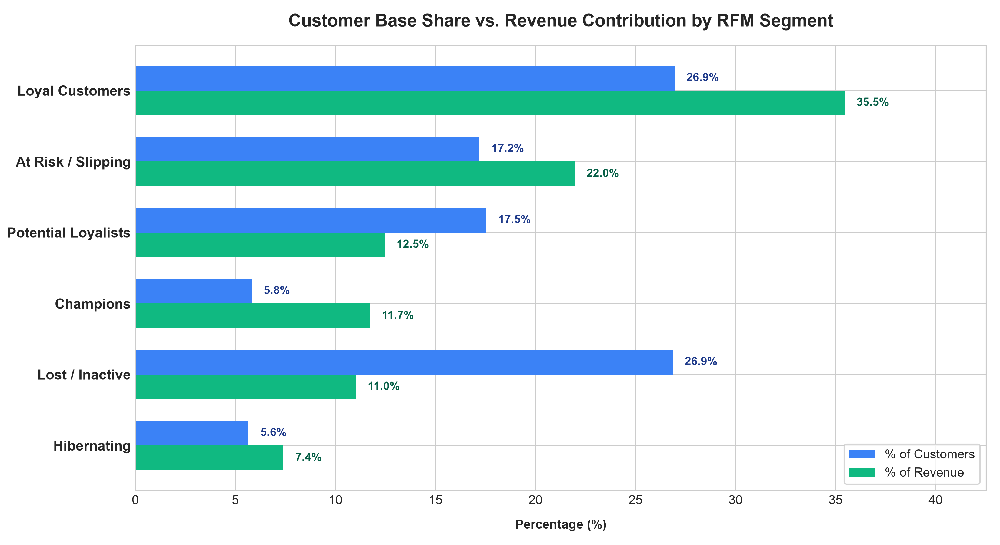
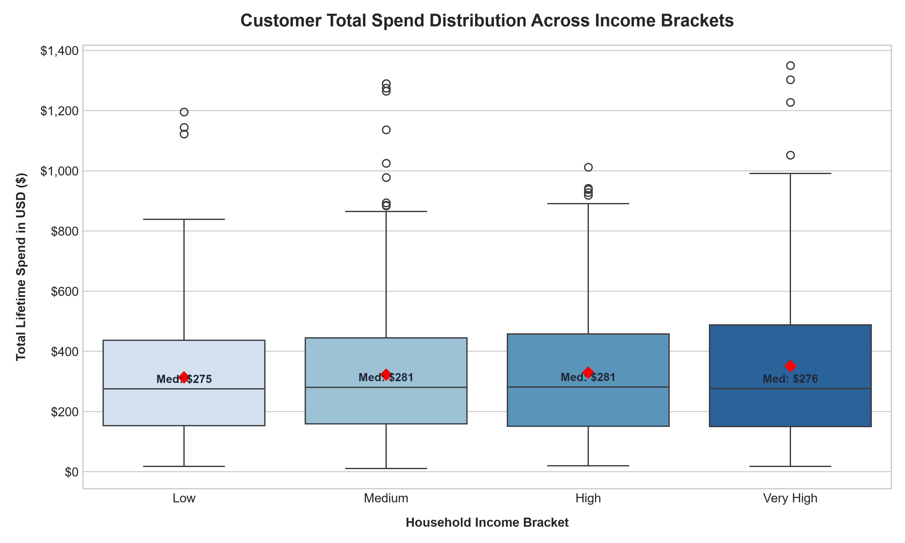
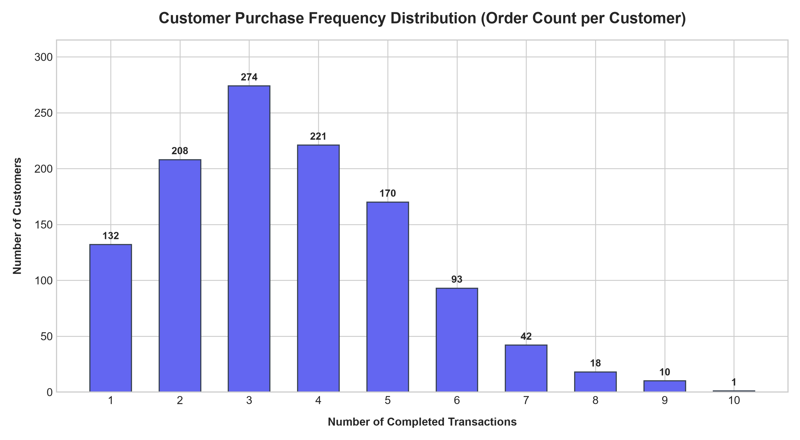
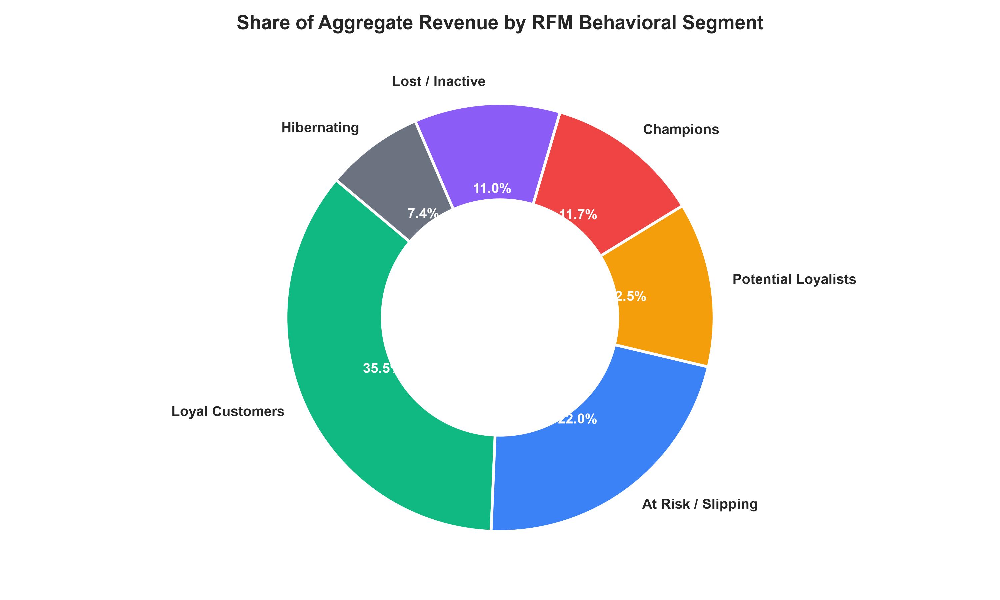
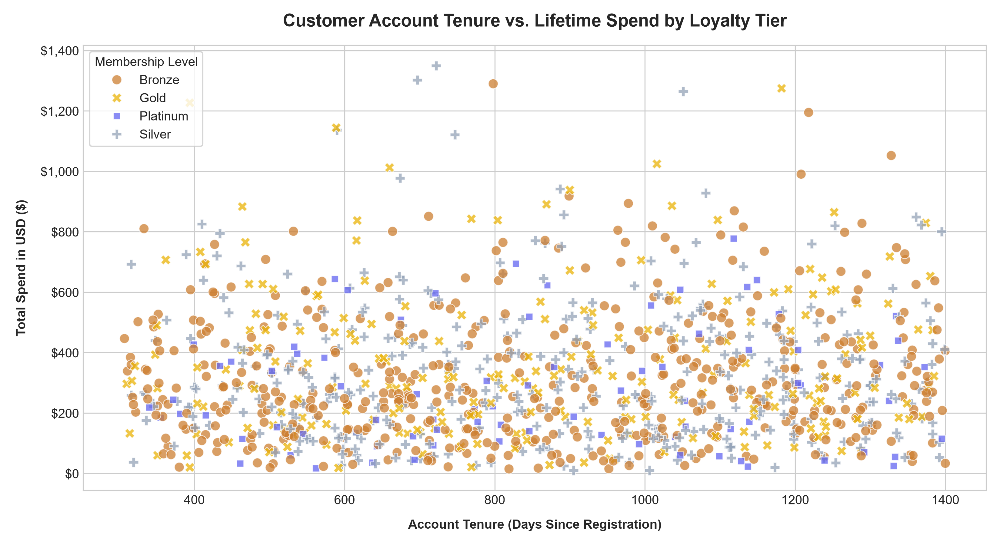

# 👥 Customer Behavior & RFM Segmentation Analysis

[](https://www.python.org/)
[](https://www.sqlite.org/)
[](https://pandas.pydata.org/)
[](https://matplotlib.org/)
[](https://seaborn.pydata.org/)
[](https://opensource.org/licenses/MIT)

> An end-to-end customer analytics portfolio project modeling 4,200 multi-channel transactions across 1,200 unique customers. Combines advanced relational SQL querying (CTEs, Window Functions) with Python RFM segmentation to discover customer purchasing behavior, lifetime spending patterns, and churn risk.

---

## 📌 Table of Contents
- [Project Overview](#-project-overview)
- [Business Problem Statement](#-business-problem-statement)
- [Relational Data Architecture](#-relational-data-architecture)
- [Data Cleaning & Engineering Pipeline](#-data-cleaning--engineering-pipeline)
- [Advanced SQL Analytics](#-advanced-sql-analytics)
- [RFM Behavioral Segmentation](#-rfm-behavioral-segmentation)
- [Key Business Insights](#-key-business-insights)
- [Visualizations Gallery](#-visualizations-gallery)
- [Strategic Action Plan & Recommendations](#-strategic-action-plan--recommendations)
- [Repository Structure](#-repository-structure)
- [How to Run & Reproduce](#-how-to-run--reproduce)

---

## 📖 Project Overview
For retail and e-commerce companies, retaining existing customers is 5 to 7 times more cost-effective than acquiring new ones. However, companies frequently lack actionable visibility into which customers drive their profits, which channels generate the most loyal engagement, and which high-value accounts are silently churning.

This project delivers a comprehensive customer intelligence framework. Transactional logs and customer demographic profiles are ingested, cleaned, and stored in an embedded SQLite relational database (`data/customer_analytics.db`). Using SQL window functions and Python analytics, customers are evaluated across Recency, Frequency, and Monetary (RFM) dimensions to unlock data-backed retention strategies.

---

## 🎯 Business Problem Statement
1. **VIP Customer Identification:** Who are our top 10 most valuable customers, and what attributes define them?
2. **Purchasing Power by Demographics:** Does customer income correlate with transaction size, and which demographic delivers the largest aggregate revenue?
3. **Channel Preference Analysis:** Are shoppers primarily adopting Mobile App, Web, or In-Store channels, and how does average order size differ by channel?
4. **Behavioral RFM Segmentation:** How do customers cluster across Champions, Loyalists, Potential Loyalists, At Risk, Hibernating, and Lost cohorts?
5. **Churn Intervention:** Which high-value customers haven't purchased in over 180 days, and what is our revenue at risk?

---

## 🗄️ Relational Data Architecture

The project features a clean two-table relational star/snowflake schema in SQLite:

```
 customers (Dimension)                         transactions (Fact)
┌───────────────────────────┐                 ┌───────────────────────────┐
│ Customer_ID (PK)          │◄────────────────┤ Transaction_ID (PK)       │
│ Age                       │       1:N       │ Customer_ID (FK)          │
│ Gender                    │                 │ Transaction_Date          │
│ City                      │                 │ Product_Category          │
│ Income_Bracket            │                 │ Purchase_Amount           │
│ Join_Date                 │                 │ Items_Count               │
│ Preferred_Category        │                 │ Payment_Type              │
│ Membership_Level          │                 │ Channel                   │
│ Satisfaction_Score        │                 └───────────────────────────┘
│ App_Usage_Hours_Month     │
└───────────────────────────┘
```

---

## ⚙️ Data Cleaning & Engineering Pipeline

The script `src/data_preprocessing.py` resolves common real-world data flaws:
- **Deduplication:** Dropped 20 duplicate customer profiles and 35 duplicate transactions.
- **Gender Standardization:** Normalized disparate input values (`'m'`, `'f'`, `'female'`, `'Male'`) into unified `'Male'`, `'Female'`, and `'Other'` categories.
- **Missing Value Imputation:**
  - `Age`: Imputed with median (36 years).
  - `Income_Bracket`: Imputed with mode (`Medium`).
  - `Satisfaction_Score`: Imputed with median (4.0).
  - `Channel`: Imputed with mode (`Mobile App`).
- **Feature Engineering:** Calculated **Recency Days** (relative to reference benchmark `2025-11-01`), **Customer Lifetime Spend**, **Order Frequency**, **Average Order Value (AOV)**, and **Account Tenure (Days)**.

---

## 💻 Advanced SQL Analytics

Production-grade SQL queries located in `sql/customer_behavior_queries.sql` demonstrate relational analytics capabilities:

### Query 1: Top 10 VIP Customers by Lifetime Spend
```sql
SELECT 
    c.Customer_ID,
    c.City,
    c.Membership_Level,
    c.Income_Bracket,
    COUNT(t.Transaction_ID) AS Total_Orders,
    SUM(t.Items_Count) AS Total_Units_Bought,
    ROUND(SUM(t.Purchase_Amount), 2) AS Lifetime_Spend,
    ROUND(AVG(t.Purchase_Amount), 2) AS Average_Order_Value
FROM customers c
INNER JOIN transactions t ON c.Customer_ID = t.Customer_ID
GROUP BY c.Customer_ID, c.City, c.Membership_Level, c.Income_Bracket
ORDER BY Lifetime_Spend DESC
LIMIT 10;
```

### Query 2: Multi-Channel Sales Share
```sql
SELECT 
    t.Channel,
    COUNT(t.Transaction_ID) AS Transaction_Count,
    ROUND(COUNT(t.Transaction_ID) * 100.0 / (SELECT COUNT(*) FROM transactions), 2) AS Transaction_Pct,
    ROUND(SUM(t.Purchase_Amount), 2) AS Total_Revenue,
    ROUND(SUM(t.Purchase_Amount) * 100.0 / (SELECT SUM(Purchase_Amount) FROM transactions), 2) AS Revenue_Pct,
    ROUND(AVG(t.Purchase_Amount), 2) AS Avg_Order_Size
FROM transactions t
GROUP BY t.Channel
ORDER BY Total_Revenue DESC;
```

### Query 3: RFM Scoring via SQL Window Functions
```sql
WITH Customer_RFM AS (
    SELECT 
        c.Customer_ID,
        CAST(JULIANDAY('2025-11-01') - JULIANDAY(MAX(t.Transaction_Date)) AS INTEGER) AS Recency_Days,
        COUNT(t.Transaction_ID) AS Frequency,
        ROUND(SUM(t.Purchase_Amount), 2) AS Monetary
    FROM customers c
    INNER JOIN transactions t ON c.Customer_ID = t.Customer_ID
    GROUP BY c.Customer_ID
),
Quartiles AS (
    SELECT 
        Customer_ID, Recency_Days, Frequency, Monetary,
        NTILE(4) OVER (ORDER BY Recency_Days DESC) AS R_Score,
        NTILE(4) OVER (ORDER BY Frequency ASC) AS F_Score,
        NTILE(4) OVER (ORDER BY Monetary ASC) AS M_Score
    FROM Customer_RFM
)
SELECT 
    CASE 
        WHEN R_Score >= 4 AND F_Score >= 4 AND M_Score >= 4 THEN 'Champions'
        WHEN R_Score >= 3 AND F_Score >= 3 THEN 'Loyal Customers'
        WHEN R_Score >= 3 AND F_Score < 3 THEN 'Potential Loyalists'
        WHEN R_Score <= 2 AND F_Score >= 3 THEN 'At Risk / Slipping'
        WHEN R_Score <= 2 AND F_Score <= 2 AND M_Score >= 3 THEN 'Hibernating'
        ELSE 'Lost / Inactive'
    END AS RFM_Segment,
    COUNT(*) AS Customer_Count,
    ROUND(SUM(Monetary), 2) AS Segment_Revenue
FROM Quartiles
GROUP BY RFM_Segment
ORDER BY Segment_Revenue DESC;
```

---

## 🎯 RFM Behavioral Segmentation

Based on 4,200 verified transactions across the active customer cohort:

| RFM Segment | Customer Count | % of Customers | Total Segment Revenue | % of Revenue | Avg. Spend | Avg. Orders | Avg. Recency |
| :--- | :--- | :--- | :--- | :--- | :--- | :--- | :--- |
| **Loyal Customers** | **315** | 26.95% | **$134,736.65** | **35.45%** | $427.74 | 4.9 | 99.4 days |
| **At Risk / Slipping** | **201** | 17.19% | **$83,437.63** | **21.95%** | $415.11 | 4.7 | 358.5 days |
| **Potential Loyalists** | **205** | 17.54% | **$47,340.20** | **12.46%** | $230.93 | 2.4 | 96.3 days |
| **Champions** | **68** | 5.82% | **$44,552.92** | **11.72%** | $655.19 | 6.5 | 39.5 days |
| **Lost / Inactive** | **314** | 26.86% | **$41,883.57** | **11.02%** | $133.39 | 1.9 | 491.2 days |
| **Hibernating** | **66** | 5.65% | **$28,120.51** | **7.40%** | $426.07 | 2.6 | 425.2 days |

---

## 💡 Key Business Insights

1. **High-Value Loyalty Concentration (Champions + Loyalists = 47.2% of Revenue):**
   - Just **32.8%** of the customer base generates nearly half of company revenue ($179.3k).
   - Champions place an average of **6.5 orders** and have purchased within the last **39.5 days**.
2. **Major Churn Exposure in 'At Risk' Cohort ($83.4k Revenue at Risk):**
   - 201 previously frequent shoppers have not purchased in nearly a full year (**358.5 days**).
   - Because their historical average spend is high ($415.11), winning back just 20% of this group recovers **~$16,600** in high-margin repeat revenue.
3. **Mobile App Dominance:**
   - The Mobile App represents **56.62%** of transactions and **$215,132.72** in revenue. Web accounts for **34.31%** ($128.5k), and physical stores capture **9.07%** ($36.4k).
4. **Income Tier Dynamics:**
   - While 'Very High' income customers exhibit the highest average transaction value ($96.40), the **Medium income tier** generates the greatest aggregate sales (**$169,357.73** across 541 customers).

---

## 🖼️ Visualizations Gallery

| Visualization | Description | Preview |
| :--- | :--- | :--- |
| **01. Segment Distribution** | Customer share % vs. revenue contribution by segment |  |
| **02. Income vs. Spend** | Boxplot of customer lifetime spending by income bracket |  |
| **03. Purchase Frequency** | Distribution of orders completed per customer |  |
| **04. RFM Revenue Contribution** | Donut chart of revenue generated per RFM tier |  |
| **05. Tenure vs. Lifetime Spend** | Scatter plot of account tenure vs spend by membership tier |  |

---

## 🚀 Strategic Action Plan & Recommendations

1. **Automated 90-Day Churn Win-Back Triggers:**
   - Establish an automated marketing workflow that triggers personalized email/SMS discounts (15% off preferred product categories) as soon as a customer surpasses 90 days of inactivity.
2. **Exclusive VIP Tier for Champions:**
   - Introduce VIP concierge perks (free express delivery, exclusive seasonal previews) for the 68 Champions to protect them from competitive poaching.
3. **App-Centric Habit Formation:**
   - Leverage mobile push notifications and app-exclusive rewards to transition "Potential Loyalists" (currently at 2.4 orders) into full "Loyal Customers".
4. **In-Store Omnichannel Capture:**
   - Physical stores boast the highest average transaction size ($95.54). Implement digital receipt QR codes to convert offline shoppers into mobile app users.

---

## 📁 Repository Structure

```
Customer-Behavior-Analysis/
│
├── data/
│   ├── raw_customer_data.csv        # Raw customer profiles (with duplicates & nulls)
│   ├── raw_transactions_data.csv    # Raw transactional logs
│   ├── cleaned_customer_data.csv    # Cleaned, standardized master dataset
│   └── customer_analytics.db        # Production SQLite relational database
│
├── sql/
│   ├── schema_and_load.sql          # DDL tables, constraints, and indexes
│   └── customer_behavior_queries.sql# Advanced CTE & window function SQL queries
│
├── notebooks/
│   └── customer_behavior_analysis.ipynb # Interactive notebook with SQL & visualizations
│
├── src/
│   ├── generate_customer_data.py    # Raw data generator
│   ├── data_preprocessing.py        # Data cleaning & SQLite database loader
│   ├── sql_analytics.py             # Python-SQL execution interface
│   ├── rfm_segmentation.py          # Quantile RFM segmentation & plotting script
│   └── create_customer_notebook.py  # Automated notebook builder
│
├── visualizations/
│   ├── 01_customer_segment_distribution.png
│   ├── 02_spending_by_income_bracket.png
│   ├── 03_purchase_frequency_distribution.png
│   ├── 04_rfm_revenue_contribution.png
│   └── 05_loyalty_tenure_vs_spend.png
│
├── requirements.txt                 # Project dependencies
├── .gitignore                       # Git ignore rules
└── README.md                        # Professional portfolio documentation
```

---

## 🛠️ How to Run & Reproduce

```bash
# 1. Clone the repository
git clone https://github.com/KKSHANMUGAM/Customer-Behavior-Analysis.git

# 2. Navigate to project root
cd Customer-Behavior-Analysis

# 3. Create and activate a virtual environment
python -m venv venv
# Windows:
venv\Scripts\activate
# Mac/Linux:
source venv/bin/activate

# 4. Install dependencies
pip install -r requirements.txt

# 5. Execute data pipeline and SQL queries
python src/data_preprocessing.py
python src/sql_analytics.py
python src/rfm_segmentation.py

# 6. Open Jupyter Notebook
jupyter notebook notebooks/customer_behavior_analysis.ipynb
```

---
**License:** Distributed under the MIT License. Feel free to use and adapt this portfolio template!
